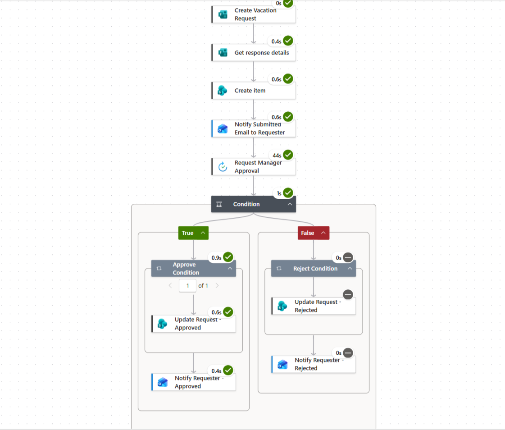

# Vacation Request Approval Workflow

An automated employee vacation request workflow built with Microsoft Power Automate and Microsoft 365 services to manage request submissions, manager approvals, status updates, and email notifications.

## Project Overview

This project automates the employee vacation request process using Microsoft Forms, Power Automate, SharePoint, and Microsoft Outlook. It provides a structured workflow for submitting requests, obtaining manager decisions, tracking request statuses, and notifying employees of the outcome.

## Business Problem

Manual vacation request processes can involve repetitive communication, follow-ups, and manual status tracking between employees and managers. This project addresses these challenges by creating a consistent process for submitting, reviewing, and tracking vacation requests.

## Workflow Process

1. **Request Submission:** An employee submits a vacation request through Microsoft Forms.
2. **Response Retrieval:** Power Automate retrieves the submitted form details.
3. **Request Record Creation:** The request information is stored in SharePoint.
4. **Submission Notification:** The requester receives an email confirming submission.
5. **Manager Approval:** The manager receives an approval request.
6. **Decision Evaluation:** A condition evaluates the approval outcome.
7. **Status Update:** SharePoint is updated with the approved or rejected status.
8. **Final Notification:** The requester receives an email with the decision.

## Tools & Technologies

- Microsoft Power Automate
- Microsoft Forms
- SharePoint
- Microsoft Outlook
- Approval Workflows
- Conditional Logic
- Workflow Automation

## Workflow Screenshots

### 1. Vacation Request Approval Workflow

This diagram illustrates the overall automated process, from request submission through manager approval and final notification.

### 2. Power Automate Project Overview

This screenshot provides an additional visual overview of the project.

## Project Outcome

The workflow establishes a consistent process for handling employee vacation requests. It connects request submission, manager approval, SharePoint status tracking, and email notifications, helping reduce manual follow-up and improve visibility into request outcomes.

## Key Skills Demonstrated

- Workflow Design and Automation
- Approval Process Management
- Microsoft 365 Integration
- Conditional Logic
- SharePoint Data Management
- Automated Email Notifications
