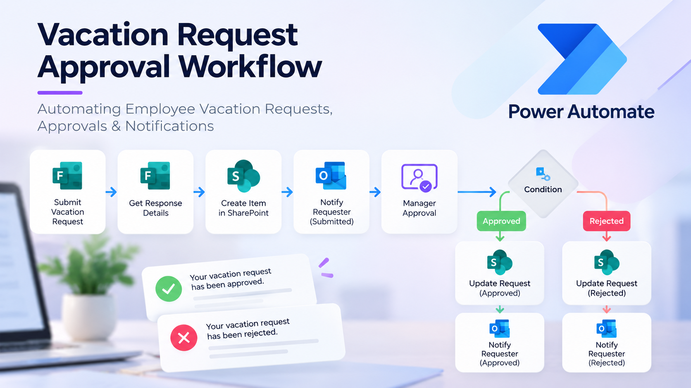

# vacation-request-approval-workflow
An automated employee vacation request workflow using Microsoft Forms, Power Automate, SharePoint, and approval notifications.

## Project Overview

This project automates the employee vacation request process using
Microsoft Power Automate and Microsoft 365 services.

## Business Problem

Manual vacation requests can require repeated communication and
follow-up between employees and managers. This workflow provides a
structured process for submitting, reviewing, and tracking requests.

## Workflow Process

1. Employee submits a vacation request through Microsoft Forms.
2. Power Automate retrieves the response details.
3. A request record is created in SharePoint.
4. The requester receives a submission notification.
5. The manager receives an approval request.
6. A condition evaluates the approval outcome.
7. SharePoint is updated with the approved or rejected status.
8. The requester receives the final notification.

## Tools & Technologies

- Microsoft Power Automate
- Microsoft Forms
- SharePoint
- Microsoft Outlook
- Approval workflows
- Conditional logic

## Workflow Diagram

</a>

## Project Outcome

The workflow provides a consistent process for handling vacation
requests, updating request status, and notifying employees of the
decision.

